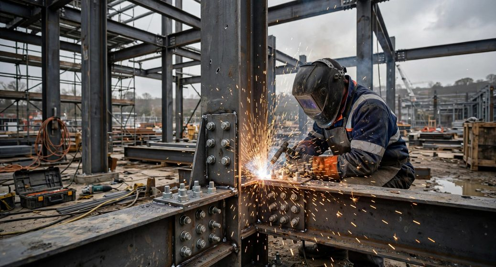
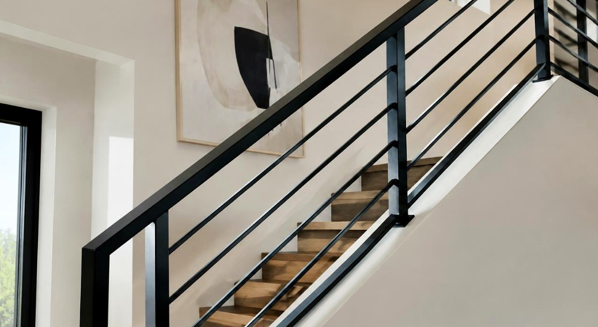
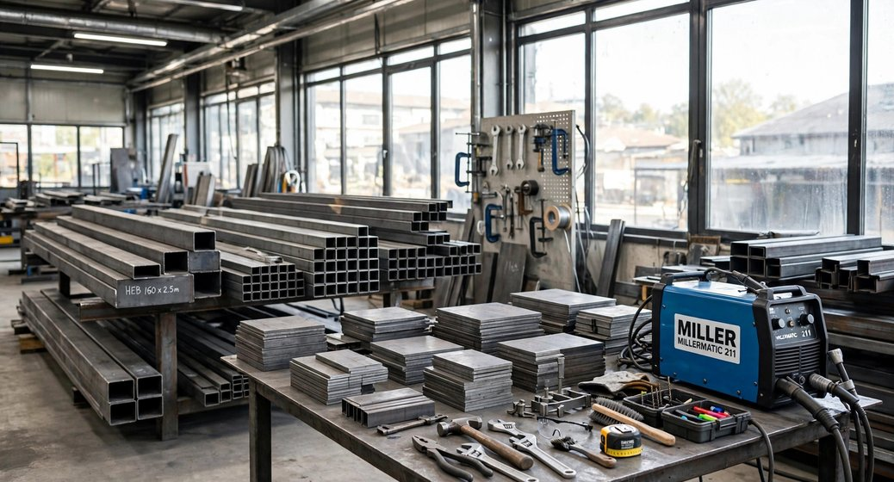

    

      <a class="btn" href="request-a-quote.html">Request a Quote →</a>
      <a class="btn outline" href="services.html">Explore Our Services</a>
    

    

      Vancouver, BC
      Lower Mainland
      Residential &amp; Commercial Enquiries
    

  

</section>

<section class="section" id="services" aria-labelledby="services-title">
  

    

      
WHAT WE DO

      <h2 id="services-title">Practical metalwork for real project requirements.</h2>
      

        From on-site welding support to custom metal details, we start by understanding
        your scope, specifications and schedule.
      

    

    

      <article class="service-card">
        
        

          
01 / CONSTRUCTION WELDING

          <h3>Construction Welding</h3>
          

            Welding and metalwork support for construction, renovation and commercial
            projects. Scope is reviewed against site conditions, drawings and project needs.
          

          <a class="text-link" href="construction-welding.html">Explore Construction Welding →</a>
        

      </article>

      <article class="service-card">
        
        

          
02 / ARCHITECTURAL METALWORK

          <h3>Architectural Metalwork</h3>
          

            Custom metal details for builders, renovation contractors, designers and
            property owners, with attention to dimensions, fit and finish.
          

          <a class="text-link" href="architectural-metalwork.html">Explore Architectural Metalwork →</a>
        

      </article>

      <article class="service-card">
        
        

          
03 / WELDING &amp; FABRICATION

          <h3>Welding &amp; Fabrication</h3>
          

            Made-to-requirement metalwork developed around your drawings, measurements,
            material choices and intended application.
          

          <a class="text-link" href="welding-fabrication.html">Explore Welding &amp; Fabrication →</a>
        

      </article>
    

  

</section>

<section class="section dark" aria-labelledby="applications-title">
  

    

      
PROJECT TYPES

      <h2 id="applications-title">Supporting the people who build and improve spaces.</h2>
      

        We welcome enquiries from construction and renovation professionals, businesses
        and property owners. Each project is assessed individually to confirm scope and fit.
      

    

    

      
01 / PROJECT TYPE<strong>New construction</strong>

      
02 / PROJECT TYPE<strong>Renovations and upgrades</strong>

      
03 / PROJECT TYPE<strong>Commercial properties</strong>

      
04 / PROJECT TYPE<strong>Architectural metal details</strong>

      
05 / PROJECT TYPE<strong>Custom components and fabrication</strong>

    

  

</section>

<section class="section" aria-labelledby="why-title">
  

    

      
THE SENSERIO APPROACH

      <h2 id="why-title">Clear scope. Careful coordination. Workable solutions.</h2>
    

    

      <article class="why">
        01
        <h3>Understand the scope</h3>
        
We begin with the work required, the site conditions and the outcome you need.

      </article>
      <article class="why">
        02
        <h3>Pay attention to detail</h3>
        
Dimensions, materials, fit, finish and relevant project specifications matter.

      </article>
      <article class="why">
        03
        <h3>Communicate clearly</h3>
        
Keep the scope, quotation, timing and next steps understandable from the outset.

      </article>
      <article class="why">
        04
        <h3>Work through the details</h3>
        
Consider practical options for the actual conditions and constraints of the project.

      </article>
      <article class="why">
        05
        <h3>Agree on the next steps</h3>
        
Confirm expectations and the proposed approach before work proceeds.

      </article>
    

  

</section>

<section class="section dark" aria-labelledby="process-title">
  

    

      
A STRAIGHTFORWARD PROCESS

      <h2 id="process-title">From first conversation to completed scope.</h2>
      
The process is tailored to the project and the work agreed upon.

    

    

      <article class="step">
        <b>01</b>
        <h3>Tell us about it</h3>
        
Share the project location, scope, drawings, photos and target timeline.

      </article>
      <article class="step">
        <b>02</b>
        <h3>Review the details</h3>
        
We review the requirements, materials, dimensions, access and site conditions.

      </article>
      <article class="step">
        <b>03</b>
        <h3>Receive a quotation</h3>
        
Discuss the proposed scope, pricing, availability and any details to confirm.

      </article>
      <article class="step">
        <b>04</b>
        <h3>Coordinate the work</h3>
        
Proceed with the agreed plan and communicate as the project moves forward.

      </article>
    

  

</section>

<section class="section" aria-labelledby="projects-title">
  

    

      
WORK &amp; APPLICATIONS

      <h2 id="projects-title">Explore common metalwork applications.</h2>
      

        The images below are illustrative examples of work types, not a representation
        of completed Senserio projects.
      

    

    

      <article class="project">
        
        

          Illustrative example
          <h3>Steel Structures &amp; Connections</h3>
          
Welded steel components and connection details used in construction.

        

      </article>

      <article class="project">
        
        

          Illustrative example
          <h3>Architectural Metalwork</h3>
          
Metal features and details that contribute to a finished space.

        

      </article>

      <article class="project">
        
        

          Illustrative example
          <h3>Custom Fabrication</h3>
          
Fabricated metal components developed for a particular application.

        

      </article>
    

    

      <a class="text-link" href="projects.html">View project applications →</a>
    

  

</section>

<section class="dark area" aria-labelledby="area-title">
  

    

      
WHERE WE WORK

      <h2 id="area-title">Serving Vancouver and the Lower Mainland.</h2>
      
Tell us where your project is located so we can confirm availability and suitability.

    

    

      Vancouver
      Burnaby
      Surrey
      North Vancouver
      West Vancouver
      Lower Mainland
    

  

</section>

<section class="cta" aria-labelledby="cta-title">
  

    

      
START A PROJECT ENQUIRY

      <h2 id="cta-title">Let’s discuss your welding or metalwork project.</h2>
      

        Send us a short description, project location, measurements, drawings or photos,
        and your expected timeline. We’ll review the information and discuss the next step.
      

    

    

      <a class="btn" href="request-a-quote.html">Request a Quote →</a>
      <a class="btn outline" href="contact.html">Contact Senserio</a>
    

  

</section>